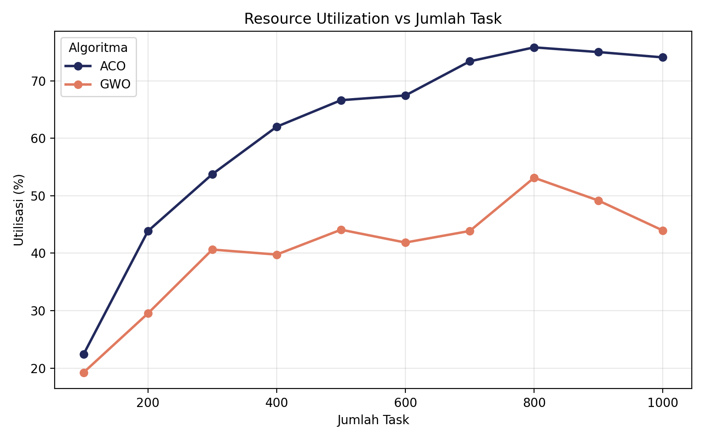
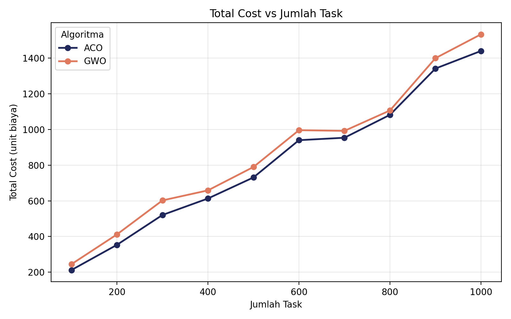

# Simulasi CloudSim Plus: ACO vs GWO (metaheuristik)

Simulasi penjadwalan task cloud dengan **Ant Colony Optimization (ACO)** dan **Grey Wolf Optimizer (GWO)** di
CloudSim Plus 8.0.0, memakai dataset GoCJ (100 sampai 1000 task, kelipatan 100). Struktur project, infrastruktur,
dan metrik mengikuti project referensi `SOKA-Heuristik` (Max-Min, Min-Min, FCFS).

## Isi folder
- `src/main/java/org/example/Main.java`: simulasi CloudSim Plus (3 datacenter x 5 host x 2 VM = 30 VM, host seed 42, VM seed 99).
- `src/main/java/org/example/MetaScheduler.java`: ACO dan GWO murni Java, porting dari engine game Cloud Ops (seed 42, 12 semut/serigala, 50 iterasi).
- `src/main/resources/dataset/`: dataset GoCJ.
- `buat_grafik.py`: membuat 5 grafik dari CSV (butuh matplotlib).
- `output/`: hasil run (`hasil_metrik_perbandingan.csv` dan `grafik/*.png`).

## Menjalankan (JDK 17+, Maven)
```bash
mvn -q compile exec:java
sudo apt install -y python3-matplotlib   # atau: pip install matplotlib
python3 buat_grafik.py
```
Keluaran: `output/output_terminal.txt` (log lengkap), `output/hasil_metrik_perbandingan.csv`, `output/grafik/*.png`.

## Teknik implementasi

### 1. Alur program
```
Dataset GoCJ  ->  Scheduler (ACO / GWO)  ->  CloudSim Plus  ->  Metrik  ->  CSV + grafik
 (panjang task)    tentukan task -> VM       jalankan jadwal     hitung       output/
 MetaScheduler.java                          Main.java           Main.java    buat_grafik.py
```
Ada dua bagian yang sengaja dipisah:
- **`MetaScheduler.java`** hanya berisi algoritma (ACO dan GWO), murni Java tanpa CloudSim. Tugasnya menghasilkan `assignment[i]` = nomor VM untuk task ke-i. Karena berdiri sendiri, algoritma bisa diuji dan dicek tanpa menjalankan simulasi.
- **`Main.java`** membuat infrastruktur CloudSim, memasang hasil scheduler ke task, menjalankan simulasi, lalu menghitung metrik. CloudSim tidak ikut memutuskan jadwal, hanya mengeksekusinya.

### 2. Teknologi
| Teknologi | Fungsi |
|---|---|
| Java 17 + Maven | Bahasa dan pengelola dependency. `mvn exec:java` menjalankan `Main`. |
| CloudSim Plus 8.0.0 | Simulator datacenter, host, VM, dan task. |
| Python + matplotlib | Membaca CSV dan menggambar 5 grafik (`buat_grafik.py`). |

### 3. Langkah satu skenario (`Main.java`, method `runScenario`)
| Langkah | Apa yang dilakukan | Kode |
|---|---|---|
| 1 | Buat 15 host dan 30 VM acak dengan seed tetap (host 42, VM 99), jadi tiap run memakai infrastruktur yang sama. | `createHosts` (baris 189), `createVms` (baris 205) |
| 2 | Bagi 30 VM ke 3 datacenter (10 VM per datacenter). | `setDatacenterMapper` (baris 132) |
| 3 | Baca dataset GoCJ. Tiap angka adalah panjang satu task (MI), dan tiap task butuh 1 PE. | `loadGoCJDataset` (baris 221) |
| 4 | Panggil scheduler (ACO atau GWO) untuk mendapat `assignment[]`. | `acoSchedule`, `gwoSchedule` |
| 5 | Pasang hasilnya: tiap task diikat ke VM tujuannya. | `bindCloudletToVm` (baris 145) |
| 6 | Jalankan simulasi. | `simulation.start()` (baris 154) |
| 7 | Hitung metrik dan tulis ke CSV. | `printMetrics` (baris 275 sampai 316) |

Scheduler VM memakai `CloudletSchedulerSpaceShared` (baris 212). Artinya task di satu VM berjalan **berurutan dan tidak saling menyela**, dan satu VM dengan 4 PE bisa menjalankan 4 task sekaligus. Sifat inilah yang membuat makespan bisa diprediksi.

### 4. Fungsi nilai: seberapa bagus satu jadwal? (`MetaScheduler.evaluate`, baris 52 sampai 62)
Untuk satu jadwal, task diproses sesuai urutan dataset. Tiap task ditaruh ke PE yang paling cepat kosong di VM tujuannya, dan durasinya = panjang task / MIPS VM. **Makespan** adalah waktu selesai terbesar.
```java
avail[best] += len[t] / mips[j];     // tambah durasi task ke PE yang paling cepat kosong
makespan = max(makespan, avail[best]);
```
Semua PE disimpan di satu array `avail[]`, dan `offset[j]` menunjukkan PE pertama milik VM j. Fungsi ini dipakai ACO dan GWO sebagai penilai. Karena meniru cara `SpaceShared` bekerja, prediksinya cocok dengan hasil CloudSim (selisih di bawah 0,16%).

### 5. ACO (`runAco`, baris 67 sampai 126)
Idenya seperti semut mencari jalur makanan: jalur yang bagus ditandai feromon, dan semut berikutnya cenderung mengikutinya.
1. **Satu semut membangun satu jadwal lengkap**, task demi task.
2. **Pilih VM secara acak berbobot** (*roulette wheel*). Bobot VM j = `feromon[task][j]` x `(1 / waktu selesai di VM j)^2`. Jadi semut tertarik ke jalur yang sudah terbukti bagus dan ke VM yang cepat menyelesaikan task.
3. **Setelah semua semut selesai (1 iterasi):**
   - Feromon menguap 20%.
   - Jadwal terbaik iterasi itu dan jadwal terbaik sepanjang waktu menambah feromon (bobot 1 dan 0,5). Ini disebut strategi *elitist*.
   - Feromon dibatasi antara 0,01 dan 10.
4. **Parameter:** 12 semut x 50 iterasi = 600 jadwal yang dievaluasi.

*Penyesuaian:* tambahan feromon dihitung `lowerBound / makespan`, dengan `lowerBound` = total MI / total kapasitas MIPS (makespan ideal). Tanpa ini, tambahan feromon akan hilang tertelan penguapan karena makespan GoCJ mencapai ribuan detik.

### 6. GWO (`runGwo`, baris 137 sampai 181)
Idenya seperti kawanan serigala yang mengepung mangsa dipimpin tiga serigala terbaik.
1. **Satu serigala = satu jadwal lengkap** (bukan satu task). Posisinya vektor bilangan real sepanjang jumlah task, tiap angka antara 0 dan 30.
2. **Diskretisasi:** nomor VM = `floor(angka)` (baris 133), supaya posisi kontinu menjadi nomor VM yang valid.
3. **Tiap iterasi:** serigala diurutkan menurut makespan. Tiga terbaik menjadi **alpha, beta, delta** (pemimpin).
4. **Gerak serigala:** setiap koordinat bergerak ke rata-rata dari langkah yang dipandu ketiga pemimpin: `leader - A x |C x leader - posisi|`. Parameter `a` turun linear dari 2 ke 0, jadi di awal serigala menjelajah luas dan di akhir mengerumun.
5. **Parameter:** 12 serigala, 50 iterasi, 612 evaluasi (hampir sama dengan ACO, jadi perbandingannya adil).

### 7. Metrik (`printMetrics`)
| Metrik | Rumus |
|---|---|
| Makespan | Waktu selesai task paling akhir |
| Throughput | Jumlah task / makespan |
| Utilisasi | Rata-rata (beban VM / (jumlah PE x makespan)) |
| Imbalance | Simpangan baku waktu selesai antar-VM (makin kecil makin merata) |
| Biaya | Jumlah (waktu selesai VM x MIPS x jumlah PE x 0,00001) |
| Gap | Selisih persen makespan prediksi (model) dan aktual (CloudSim) |

### 8. Cara memastikan implementasi benar
- **Porting dari engine game** (ACO dan GWO di project Cloud Ops) ke Java, dengan parameter yang sama.
- **Validasi infrastruktur dan fungsi nilai:** FCFS dan Max-Min dihitung ulang dengan model yang sama dan hasilnya identik dengan CSV project referensi `SOKA-Heuristik` (misalnya 910,0101 dan 2514,1431).
- **Validasi prediksi lawan simulasi:** selisih makespan model dan CloudSim di bawah 0,16% pada semua skenario.
- **Cek kelengkapan:** semua task selesai pada tiap skenario dan tidak ada error di log.

### 9. Istilah singkat
- **Heuristik vs metaheuristik:** heuristik (Max-Min, FCFS) adalah aturan tetap yang hasilnya selalu sama. Metaheuristik (ACO, GWO) adalah pencarian acak berpopulasi yang memperbaiki hasilnya tiap iterasi.
- **Seed:** angka awal pembangkit acak, supaya hasil bisa diulang persis.
- **Makespan:** total waktu sampai semua task selesai. Tujuan optimasi adalah membuatnya sekecil mungkin.
- **MI dan MIPS:** MI = juta instruksi (ukuran task), MIPS = juta instruksi per detik (kecepatan VM).

## Hasil
`Prediksi_Makespan` adalah makespan dari model penjadwalan; `Makespan_Aktual` dari simulasi CloudSim. Selisih keduanya di bawah 0,16% pada semua skenario.

| N task | ACO makespan (s) | GWO makespan (s) | ACO util (%) | GWO util (%) | ACO biaya | GWO biaya |
|---:|---:|---:|---:|---:|---:|---:|
| 100 | 933.9 | 1363.9 | 22.4 | 19.2 | 212 | 245 |
| 200 | 1102.9 | 1936.9 | 43.9 | 29.5 | 353 | 412 |
| 300 | 1433.7 | 2213.6 | 53.8 | 40.6 | 521 | 602 |
| 400 | 1590.4 | 3121.0 | 62.0 | 39.8 | 613 | 659 |
| 500 | 1839.8 | 3350.5 | 66.6 | 44.1 | 731 | 789 |
| 600 | 2247.0 | 4558.7 | 67.5 | 41.9 | 940 | 996 |
| 700 | 2254.7 | 4603.9 | 73.4 | 43.9 | 953 | 992 |
| 800 | 2501.1 | 4317.2 | 75.8 | 53.1 | 1082 | 1106 |
| 900 | 3000.3 | 5417.2 | 75.0 | 49.2 | 1341 | 1399 |
| 1000 | 3322.6 | 6752.7 | 74.1 | 44.0 | 1439 | 1533 |

Semua task selesai pada tiap skenario. Detail lengkap (throughput, imbalance, gap prediksi) ada di `output/hasil_metrik_perbandingan.csv`.






## Catatan dan keterbatasan
- ACO unggul di semua metrik pada dataset dan seed ini. Satu seed belum membuktikan ACO selalu lebih baik.
- GWO adalah versi dasar (tebakan awal acak, 50 iterasi) dan mencari di ratusan dimensi, sehingga tertinggal jauh pada jumlah task besar. Hasil ini bukan klaim bahwa GWO lebih buruk secara umum.
- Konstanta Q pada ACO diskalakan ke batas bawah makespan agar deposit feromon tidak hilang pada makespan ribuan detik.
- Pembangkit angka acak memakai `java.util.Random`, sehingga tidak identik bit-per-bit dengan engine JavaScript game.
- Biaya adalah unit simulasi, bukan tarif cloud nyata.

## Kredit
- Dataset **GoCJ** (Google Cloud Jobs) dari repositori dataset publik yang dipakai project referensi.
- Struktur simulasi mengikuti project referensi `SOKA-Heuristik`.
- Engine ACO/GWO berasal dari project Cloud Ops: Scheduling Adventure (Kelompok 8).
