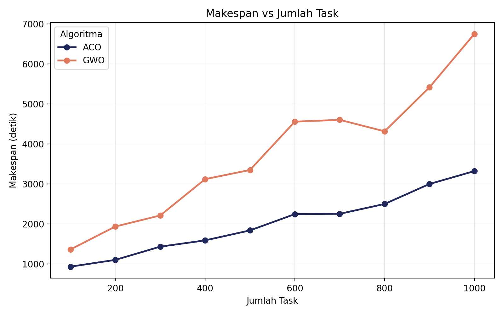
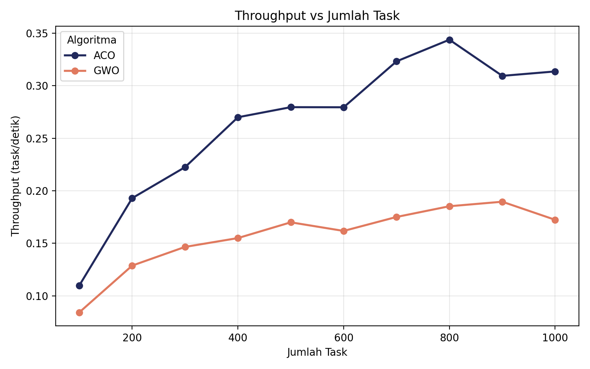
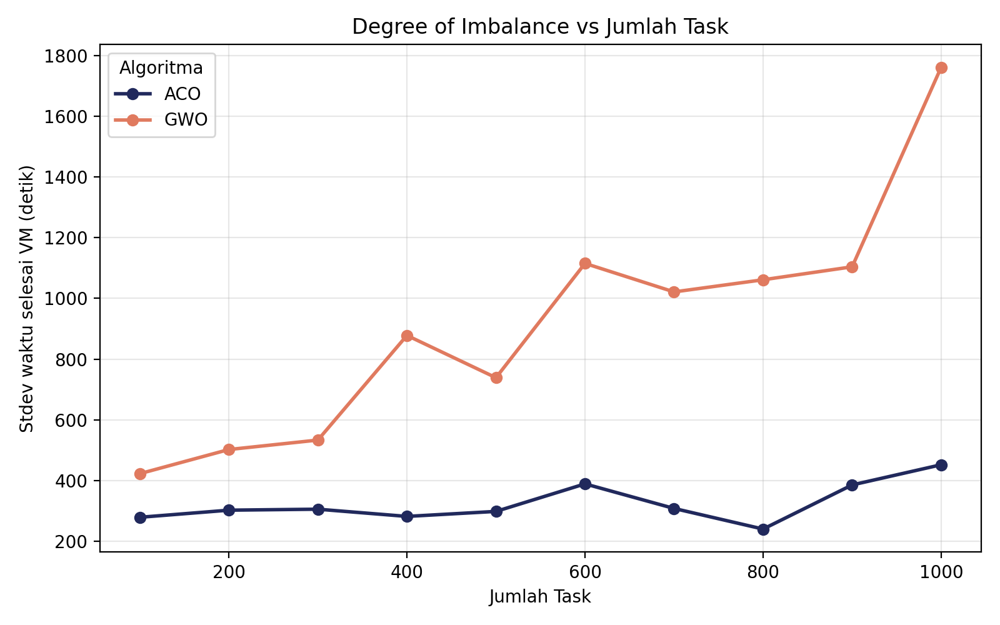

# Simulasi CloudSim Plus: ACO vs GWO (metaheuristik)

## Kelompok

Nama | NRP
--- | ---
Rizqi Akbar Sukirman Putra | 5027241044
Muhammad Farrel Rafli Al Fasya | 5027241075
Mohammad Abyan Ranuaji | 5027241106
Yasykur Khalis Jati Maulana Yuwono | 5027241112
Mohamad Arkan Zahir Asyafiq | 5027241120

Simulasi penjadwalan task cloud dengan **Ant Colony Optimization (ACO)** dan **Grey Wolf Optimizer (GWO)** di
CloudSim Plus 8.0.0, memakai dataset GoCJ (100 sampai 1000 task, kelipatan 100). Struktur project, infrastruktur,
dan metrik mengikuti project referensi `SOKA-Heuristik` (Max-Min, Min-Min, FCFS).

## Isi folder
- `src/main/java/org/example/Main.java`: simulasi CloudSim Plus (3 datacenter x 5 host x 2 VM = 30 VM, host seed 42, VM seed 99).
- `src/main/java/org/example/MetaScheduler.java`: ACO dan GWO murni Java, porting dari engine game Cloud Ops (seed 42, 12 semut/serigala, 50 iterasi).
- `src/main/resources/dataset/`: dataset GoCJ.
- `buat_grafik.py`: membuat 5 grafik dari CSV (butuh matplotlib).
- `output/`: hasil run (`hasil_metrik_perbandingan.csv` dan `grafik/*.png`).

## Menjalankan (JDK 17+, Maven)
```bash
mvn -q compile exec:java
sudo apt install -y python3-matplotlib   # atau: pip install matplotlib
python3 buat_grafik.py
```
Keluaran: `output/output_terminal.txt` (log lengkap), `output/hasil_metrik_perbandingan.csv`, `output/grafik/*.png`.

## Hasil
`Prediksi_Makespan` adalah makespan dari model penjadwalan; `Makespan_Aktual` dari simulasi CloudSim. Selisih keduanya di bawah 0,16% pada semua skenario.

| N task | ACO makespan (s) | GWO makespan (s) | ACO util (%) | GWO util (%) | ACO biaya | GWO biaya |
|---:|---:|---:|---:|---:|---:|---:|
| 100 | 933.9 | 1363.9 | 22.4 | 19.2 | 212 | 245 |
| 200 | 1102.9 | 1936.9 | 43.9 | 29.5 | 353 | 412 |
| 300 | 1433.7 | 2213.6 | 53.8 | 40.6 | 521 | 602 |
| 400 | 1590.4 | 3121.0 | 62.0 | 39.8 | 613 | 659 |
| 500 | 1839.8 | 3350.5 | 66.6 | 44.1 | 731 | 789 |
| 600 | 2247.0 | 4558.7 | 67.5 | 41.9 | 940 | 996 |
| 700 | 2254.7 | 4603.9 | 73.4 | 43.9 | 953 | 992 |
| 800 | 2501.1 | 4317.2 | 75.8 | 53.1 | 1082 | 1106 |
| 900 | 3000.3 | 5417.2 | 75.0 | 49.2 | 1341 | 1399 |
| 1000 | 3322.6 | 6752.7 | 74.1 | 44.0 | 1439 | 1533 |

Semua task selesai pada tiap skenario. Detail lengkap (throughput, imbalance, gap prediksi) ada di `output/hasil_metrik_perbandingan.csv`.







## Catatan dan keterbatasan
- ACO unggul di semua metrik pada dataset dan seed ini. Satu seed belum membuktikan ACO selalu lebih baik.
- GWO adalah versi dasar (tebakan awal acak, 50 iterasi) dan mencari di ratusan dimensi, sehingga tertinggal jauh pada jumlah task besar. Hasil ini bukan klaim bahwa GWO lebih buruk secara umum.
- Konstanta Q pada ACO diskalakan ke batas bawah makespan agar deposit feromon tidak hilang pada makespan ribuan detik.
- Pembangkit angka acak memakai `java.util.Random`, sehingga tidak identik bit-per-bit dengan engine JavaScript game.
- Biaya adalah unit simulasi, bukan tarif cloud nyata.

## Kredit
- Dataset **GoCJ** (Google Cloud Jobs) dari repositori dataset publik yang dipakai project referensi.
- Struktur simulasi mengikuti project referensi `SOKA-Heuristik`.
- Engine ACO/GWO berasal dari project Cloud Ops: Scheduling Adventure (Kelompok 8).
