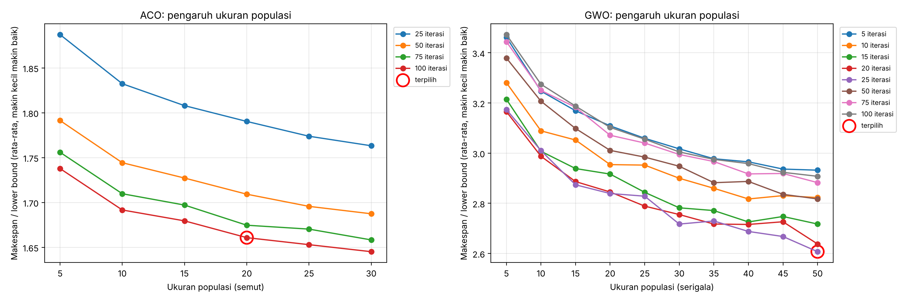
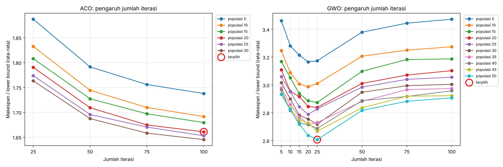
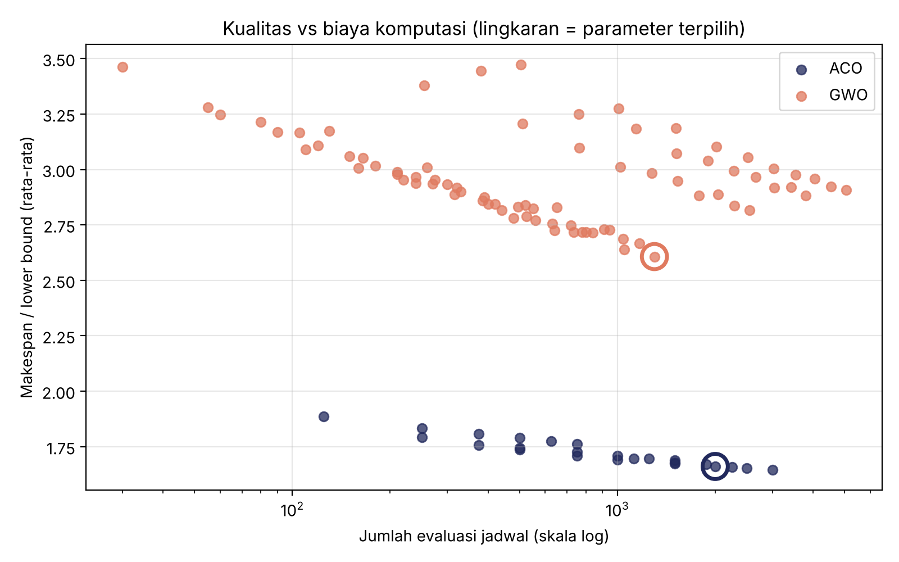
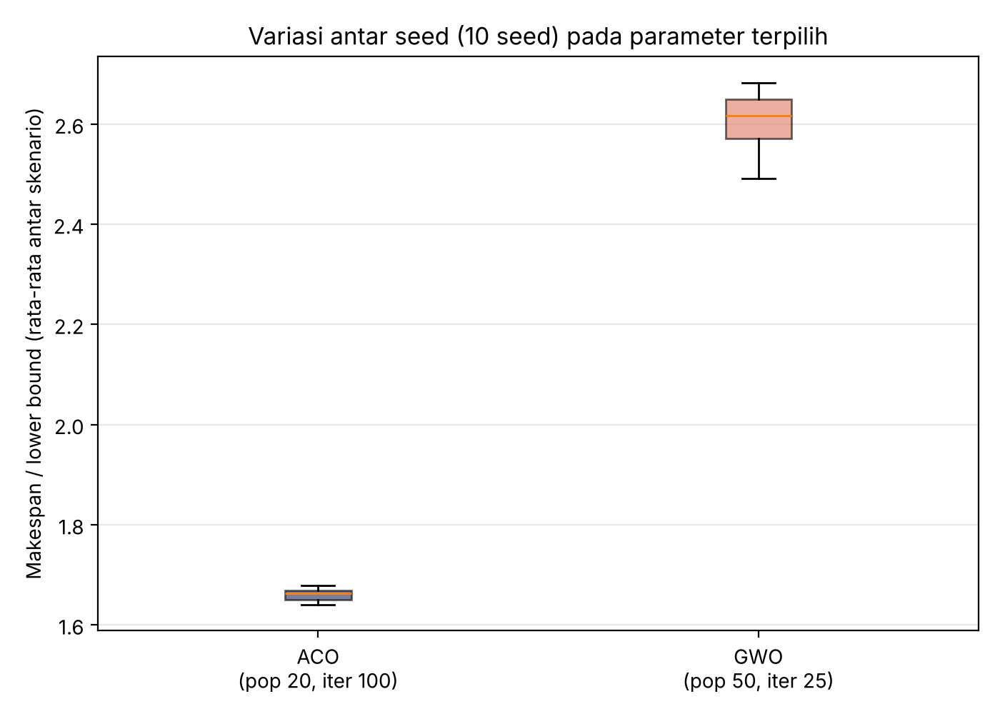

# Simulasi CloudSim Plus: ACO vs GWO (metaheuristik)

Simulasi penjadwalan task cloud dengan **Ant Colony Optimization (ACO)** dan **Grey Wolf Optimizer (GWO)** di
CloudSim Plus 8.0.0, memakai dataset GoCJ (100 sampai 1000 task, kelipatan 100). Struktur project, infrastruktur,
dan metrik mengikuti project referensi `SOKA-Heuristik` (Max-Min, Min-Min, FCFS).

## Isi folder
- `src/main/java/org/example/Main.java`: simulasi CloudSim Plus (3 datacenter x 5 host x 2 VM = 30 VM, host seed 42, VM seed 99).
- `src/main/java/org/example/MetaScheduler.java`: ACO dan GWO murni Java, porting dari engine game Cloud Ops. Parameter (populasi, iterasi) hasil tuning.
- `src/main/resources/dataset/`: dataset GoCJ.
- `src/main/java/org/example/Tuning.java`: pengujian parameter ACO dan GWO (tanpa CloudSim).
- `buat_grafik.py`: membuat 5 grafik hasil simulasi dari CSV (butuh matplotlib).
- `buat_grafik_tuning.py`: membuat grafik tuning dan memilih parameter terbaik.
- `output/`: hasil tuning (`tuning_*.csv`, `grafik_tuning/`, `parameter_terpilih.txt`), hasil simulasi dengan parameter awal (`parameter_awal/`), dan hasil simulasi dengan parameter terpilih (dibuat saat `Main` dijalankan).

## Menjalankan (JDK 17+, Maven)
```bash
mvn -q compile exec:java                                       # simulasi CloudSim dengan parameter terpilih
mvn -q compile exec:java -Dexec.mainClass=org.example.Tuning   # (opsional) ulangi tuning, sekitar 15 menit
python3 buat_grafik_tuning.py                                  # grafik tuning dan parameter terpilih
sudo apt install -y python3-matplotlib   # atau: pip install matplotlib
python3 buat_grafik.py
```
Keluaran: `output/output_terminal.txt` (log lengkap), `output/hasil_metrik_perbandingan.csv`, `output/grafik/*.png`.

## Teknik implementasi

### 1. Alur program
```
Dataset GoCJ  ->  Scheduler (ACO / GWO)  ->  CloudSim Plus  ->  Metrik  ->  CSV + grafik
 (panjang task)    tentukan task -> VM       jalankan jadwal     hitung       output/
 MetaScheduler.java                          Main.java           Main.java    buat_grafik.py
```
Ada dua bagian yang sengaja dipisah:
- **`MetaScheduler.java`** hanya berisi algoritma (ACO dan GWO), murni Java tanpa CloudSim. Tugasnya menghasilkan `assignment[i]` = nomor VM untuk task ke-i. Karena berdiri sendiri, algoritma bisa diuji dan dicek tanpa menjalankan simulasi.
- **`Main.java`** membuat infrastruktur CloudSim, memasang hasil scheduler ke task, menjalankan simulasi, lalu menghitung metrik. CloudSim tidak ikut memutuskan jadwal, hanya mengeksekusinya.

### 2. Teknologi
| Teknologi | Fungsi |
|---|---|
| Java 17 + Maven | Bahasa dan pengelola dependency. `mvn exec:java` menjalankan `Main`. |
| CloudSim Plus 8.0.0 | Simulator datacenter, host, VM, dan task. |
| Python + matplotlib | Membaca CSV dan menggambar 5 grafik (`buat_grafik.py`). |

### 3. Langkah satu skenario (`Main.java`, method `runScenario`)
| Langkah | Apa yang dilakukan | Kode |
|---|---|---|
| 1 | Buat 15 host dan 30 VM acak dengan seed tetap (host 42, VM 99), jadi tiap run memakai infrastruktur yang sama. | `createHosts` (baris 189), `createVms` (baris 205) |
| 2 | Bagi 30 VM ke 3 datacenter (10 VM per datacenter). | `setDatacenterMapper` (baris 132) |
| 3 | Baca dataset GoCJ. Tiap angka adalah panjang satu task (MI), dan tiap task butuh 1 PE. | `loadGoCJDataset` (baris 221) |
| 4 | Panggil scheduler (ACO atau GWO) untuk mendapat `assignment[]`. | `acoSchedule`, `gwoSchedule` |
| 5 | Pasang hasilnya: tiap task diikat ke VM tujuannya. | `bindCloudletToVm` (baris 145) |
| 6 | Jalankan simulasi. | `simulation.start()` (baris 154) |
| 7 | Hitung metrik dan tulis ke CSV. | `printMetrics` (baris 275 sampai 316) |

Scheduler VM memakai `CloudletSchedulerSpaceShared` (baris 212). Artinya task di satu VM berjalan **berurutan dan tidak saling menyela**, dan satu VM dengan 4 PE bisa menjalankan 4 task sekaligus. Sifat inilah yang membuat makespan bisa diprediksi.

### 4. Fungsi nilai: seberapa bagus satu jadwal? (`MetaScheduler.evaluate`, baris 52 sampai 62)
Untuk satu jadwal, task diproses sesuai urutan dataset. Tiap task ditaruh ke PE yang paling cepat kosong di VM tujuannya, dan durasinya = panjang task / MIPS VM. **Makespan** adalah waktu selesai terbesar.
```java
avail[best] += len[t] / mips[j];     // tambah durasi task ke PE yang paling cepat kosong
makespan = max(makespan, avail[best]);
```
Semua PE disimpan di satu array `avail[]`, dan `offset[j]` menunjukkan PE pertama milik VM j. Fungsi ini dipakai ACO dan GWO sebagai penilai. Karena meniru cara `SpaceShared` bekerja, prediksinya cocok dengan hasil CloudSim (selisih di bawah 0,16%).

### 5. ACO (`runAco`, baris 67 sampai 126)
Idenya seperti semut mencari jalur makanan: jalur yang bagus ditandai feromon, dan semut berikutnya cenderung mengikutinya.
1. **Satu semut membangun satu jadwal lengkap**, task demi task.
2. **Pilih VM secara acak berbobot** (*roulette wheel*). Bobot VM j = `feromon[task][j]` x `(1 / waktu selesai di VM j)^2`. Jadi semut tertarik ke jalur yang sudah terbukti bagus dan ke VM yang cepat menyelesaikan task.
3. **Setelah semua semut selesai (1 iterasi):**
   - Feromon menguap 20%.
   - Jadwal terbaik iterasi itu dan jadwal terbaik sepanjang waktu menambah feromon (bobot 1 dan 0,5). Ini disebut strategi *elitist*.
   - Feromon dibatasi antara 0,01 dan 10.
4. **Parameter (hasil tuning):** 20 semut x 100 iterasi = 2000 jadwal yang dievaluasi.

*Penyesuaian:* tambahan feromon dihitung `lowerBound / makespan`, dengan `lowerBound` = total MI / total kapasitas MIPS (makespan ideal). Tanpa ini, tambahan feromon akan hilang tertelan penguapan karena makespan GoCJ mencapai ribuan detik.

### 6. GWO (`runGwo`, baris 137 sampai 181)
Idenya seperti kawanan serigala yang mengepung mangsa dipimpin tiga serigala terbaik.
1. **Satu serigala = satu jadwal lengkap** (bukan satu task). Posisinya vektor bilangan real sepanjang jumlah task, tiap angka antara 0 dan 30.
2. **Diskretisasi:** nomor VM = `floor(angka)` (baris 133), supaya posisi kontinu menjadi nomor VM yang valid.
3. **Tiap iterasi:** serigala diurutkan menurut makespan. Tiga terbaik menjadi **alpha, beta, delta** (pemimpin).
4. **Gerak serigala:** setiap koordinat bergerak ke rata-rata dari langkah yang dipandu ketiga pemimpin: `leader - A x |C x leader - posisi|`. Parameter `a` turun linear dari 2 ke 0, jadi di awal serigala menjelajah luas dan di akhir mengerumun.
5. **Parameter (hasil tuning):** 50 serigala, 25 iterasi = 50 x (25 + 1) = 1300 evaluasi. Anggaran evaluasi kedua algoritma tidak sama karena masing-masing memakai parameter optimalnya sendiri (lihat bagian Tuning parameter).

### 7. Metrik (`printMetrics`)
| Metrik | Rumus |
|---|---|
| Makespan | Waktu selesai task paling akhir |
| Throughput | Jumlah task / makespan |
| Utilisasi | Rata-rata (beban VM / (jumlah PE x makespan)) |
| Imbalance | Simpangan baku waktu selesai antar-VM (makin kecil makin merata) |
| Biaya | Jumlah (waktu selesai VM x MIPS x jumlah PE x 0,00001) |
| Gap | Selisih persen makespan prediksi (model) dan aktual (CloudSim) |

### 8. Cara memastikan implementasi benar
- **Porting dari engine game** (ACO dan GWO di project Cloud Ops) ke Java, dengan parameter yang sama.
- **Validasi infrastruktur dan fungsi nilai:** FCFS dan Max-Min dihitung ulang dengan model yang sama dan hasilnya identik dengan CSV project referensi `SOKA-Heuristik` (misalnya 910,0101 dan 2514,1431).
- **Validasi prediksi lawan simulasi:** selisih makespan model dan CloudSim di bawah 0,16% pada semua skenario.
- **Cek kelengkapan:** semua task selesai pada tiap skenario dan tidak ada error di log.

### 9. Istilah singkat
- **Heuristik vs metaheuristik:** heuristik (Max-Min, FCFS) adalah aturan tetap yang hasilnya selalu sama. Metaheuristik (ACO, GWO) adalah pencarian acak berpopulasi yang memperbaiki hasilnya tiap iterasi.
- **Seed:** angka awal pembangkit acak, supaya hasil bisa diulang persis. Seed bukan parameter yang dituning; variasi antar seed dilaporkan pada bagian Tuning parameter.
- **Makespan:** total waktu sampai semua task selesai. Tujuan optimasi adalah membuatnya sekecil mungkin.
- **MI dan MIPS:** MI = juta instruksi (ukuran task), MIPS = juta instruksi per detik (kecepatan VM).

## Tuning parameter
Parameter awal (12 semut/serigala, 50 iterasi) hanya diambil dari engine game. Di bagian ini ukuran populasi dan jumlah iterasi diuji untuk mencari yang paling baik bagi masing-masing algoritma.

**Cara pengujian** (`Tuning.java`, jumlahnya 10.400 run):
- Pengujian memakai model penjadwalan yang sama dengan `Main` tanpa CloudSim, karena hasilnya cocok dengan CloudSim (selisih di bawah 0,16%) dan jauh lebih cepat.
- Setiap kombinasi dijalankan pada 10 skenario (100 sampai 1000 task) dan 10 seed (1 sampai 10).
- Ukuran yang dibandingkan: makespan dibagi lower bound (makespan ideal bila beban terbagi sempurna). Nilai 1,00 berarti ideal dan makin kecil makin baik. Normalisasi ini membuat skenario berbeda bisa dirata-rata dengan adil.
- ACO: populasi 5 sampai 30 (kelipatan 5) x iterasi 25, 50, 75, 100. GWO: populasi 5 sampai 50 (kelipatan 5) x iterasi 5, 10, 15, 20, 25, 50, 75, 100. Rentang GWO diperluas karena hasil terbaiknya ada di iterasi kecil.
- **Aturan pemilihan:** populasi dan iterasi yang lebih besar hampir selalu lebih baik tetapi lebih mahal. Maka dipilih konfigurasi dengan jumlah evaluasi paling sedikit yang skornya masih dalam 1% dari skor terbaik.

**Parameter terpilih** (boleh berbeda antar algoritma):
| Algoritma | Populasi | Iterasi | Evaluasi | Skor rata-rata | Simpangan antar seed |
|---|---:|---:|---:|---:|---:|
| ACO | 20 | 100 | 2000 | 1,661 | 0,012 |
| GWO | 50 | 25 | 1300 | 2,607 | 0,056 |

Skor terbaik mutlak ACO adalah populasi 30 dan iterasi 100 (1,645), hanya 0,9% lebih baik dengan evaluasi 50% lebih banyak, sehingga tidak dipilih. Detail semua kombinasi ada di `output/tuning_ringkasan.csv`.






**Temuan:**
1. **ACO:** makin besar populasi dan iterasi, makin baik, dengan manfaat yang makin kecil (diminishing returns).
2. **GWO:** populasi lebih besar membuat hasil lebih baik, tetapi **iterasi optimal hanya sekitar 20 sampai 25**. Iterasi yang lebih banyak justru memperburuk hasil (skor 2,61 pada 25 iterasi menjadi 2,91 pada 100 iterasi untuk populasi 50). Dugaan penyebabnya: pada implementasi game, tiga pemimpin (alpha, beta, delta) diambil dari populasi pada iterasi itu, bukan dari yang terbaik sepanjang waktu seperti pada GWO standar. Uji tambahan kecil (5 seed, populasi 30) mendukung dugaan ini, yaitu pada 100 iterasi pemimpin terbaik-sepanjang-waktu lebih baik (N=300: 2,58 dibanding 3,11; N=1000: 2,36 dibanding 2,45), tetapi pada 25 iterasi untuk N=1000 hasilnya tidak lebih baik (2,45 dibanding 2,29). Jadi ini indikasi, bukan kesimpulan, dan algoritma di project ini tidak diubah.
3. **Seed:** variasi antar seed kecil untuk ACO (0,012) dan lebih besar untuk GWO (0,056), tetapi selisih ACO dan GWO (1,66 dibanding 2,61) jauh lebih besar daripada variasi itu. Seed tidak dituning karena memilih seed terbaik adalah cherry-picking; simulasi akhir memakai seed 42.
4. **Batas pengujian:** populasi GWO terbaik ada di tepi rentang (50), jadi populasi lebih besar mungkin sedikit lebih baik. Rentang dibatasi supaya anggaran evaluasi GWO sebanding dengan ACO.

## Hasil

### Prediksi makespan: parameter awal dibanding parameter hasil tuning
Makespan model penjadwalan (seed 42), dalam detik. Pada parameter awal, model ini selisihnya di bawah 0,16% dari hasil CloudSim.

| N task | ACO awal (12x50) | ACO tuning (20x100) | Perbaikan | GWO awal (12x50) | GWO tuning (50x25) | Perbaikan |
|---:|---:|---:|---:|---:|---:|---:|
| 100 | 933.4 | 910.0 | 2.5% | 1363.5 | 1185.5 | 13.1% |
| 200 | 1102.2 | 1035.8 | 6.0% | 1935.9 | 1552.3 | 19.8% |
| 300 | 1432.5 | 1347.5 | 5.9% | 2212.7 | 2045.5 | 7.6% |
| 400 | 1589.4 | 1480.5 | 6.9% | 3116.1 | 2579.6 | 17.2% |
| 500 | 1837.9 | 1786.4 | 2.8% | 3345.8 | 2938.8 | 12.2% |
| 600 | 2245.7 | 2145.1 | 4.5% | 4556.0 | 3705.4 | 18.7% |
| 700 | 2253.4 | 2163.5 | 4.0% | 4600.0 | 3993.4 | 13.2% |
| 800 | 2498.4 | 2324.5 | 7.0% | 4312.0 | 4312.0 | 0.0% |
| 900 | 2997.4 | 2906.0 | 3.0% | 5414.3 | 4746.4 | 12.3% |
| 1000 | 3318.7 | 3185.2 | 4.0% | 6746.4 | 5793.2 | 14.1% |

Parameter hasil tuning memperbaiki ACO di semua skenario dan GWO di 9 dari 10 skenario (N=800 sama).

### Hasil simulasi CloudSim
- **Parameter awal (12 x 50)** sudah dijalankan di CloudSim, hasilnya ada di `output/parameter_awal/` (CSV dan grafik). Semua task selesai pada tiap skenario, dan selisih prediksi dibanding simulasi di bawah 0,16%.
- **Parameter hasil tuning** dijalankan dengan `mvn -q compile exec:java`, lalu `python3 buat_grafik.py`. Hasilnya muncul di `output/hasil_metrik_perbandingan.csv` dan `output/grafik/`.


## Catatan dan keterbatasan
- ACO unggul pada dataset ini. Pada 10 seed, selisih ACO dan GWO jauh lebih besar daripada variasi antar seed, tetapi hanya satu dataset (GoCJ) yang diuji.
- GWO adalah versi dasar (tebakan awal acak, pemimpin dari populasi saat itu) dan mencari di ratusan dimensi, sehingga tertinggal jauh pada jumlah task besar. Hasil ini bukan klaim bahwa GWO lebih buruk secara umum.
- Konstanta Q pada ACO diskalakan ke batas bawah makespan agar deposit feromon tidak hilang pada makespan ribuan detik.
- Pembangkit angka acak memakai `java.util.Random`, sehingga tidak identik bit-per-bit dengan engine JavaScript game.
- Biaya adalah unit simulasi, bukan tarif cloud nyata.

## Kredit
- Dataset **GoCJ** (Google Cloud Jobs) dari repositori dataset publik yang dipakai project referensi.
- Struktur simulasi mengikuti project referensi `SOKA-Heuristik`.
- Engine ACO/GWO berasal dari project Cloud Ops: Scheduling Adventure (Kelompok 8).
